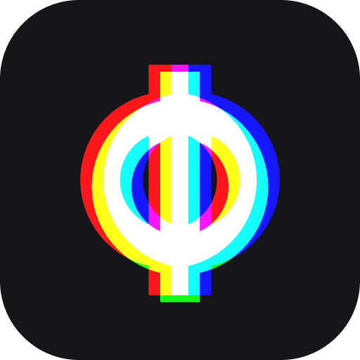
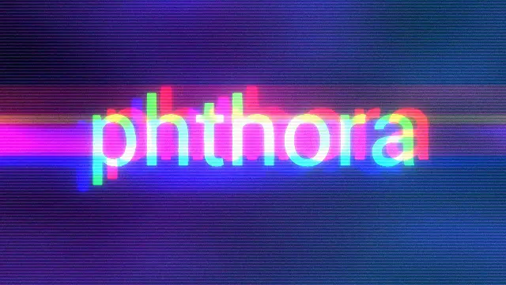
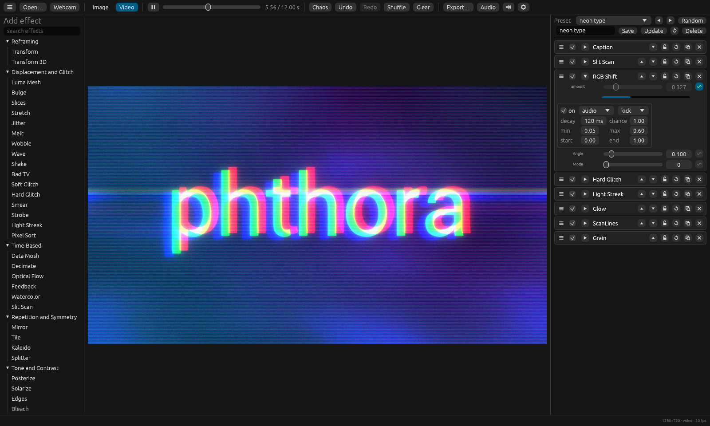
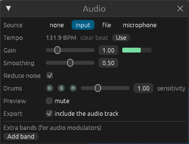
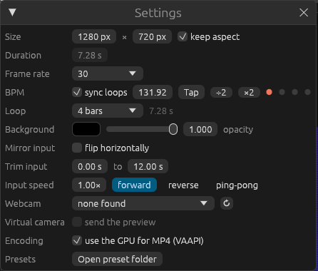

<div align="center">



# phthora

**Real-time GPU effect mixer for images, video and GIFs – that moves with the beat.**

[](https://github.com/romanvesely/phthora/releases/latest)
[](https://github.com/romanvesely/phthora/actions/workflows/ci.yml)
[](#license)


[Download](#download) · [Highlights](#highlights) · [Quick start](#quick-start) · [Command line](#command-line) · [Build from source](#build-from-source)



<sub>Rendered by phthora: RGB shift on the kick, hard glitch on the clap, two bars cut at the detected tempo.</sub>

</div>

<br>

Load a picture, a clip or your webcam, stack effects and let them move – by curves, by the
kick, snare and hi-hat of your track, or by a MIDI controller. Everything renders on the GPU,
so the preview runs at full frame rate, and the export looks exactly like the preview: as a
video, GIF, animated WebP, APNG, image sequence or still.



## Download

| System | Download | Notes |
|---|---|---|
| **Linux** (x86_64) | [AppImage](https://github.com/romanvesely/phthora/releases/latest) · [tar.gz](https://github.com/romanvesely/phthora/releases/latest) | Needs `ffmpeg` (4.4 or newer) from your distribution. Make the AppImage executable (`chmod +x`) and start it. |
| **Windows** 10/11 (x64) | [zip](https://github.com/romanvesely/phthora/releases/latest) | ffmpeg included. Unzip, start `phthora.exe`. SmartScreen: *More info → Run anyway*. |
| **macOS** 11+ (Apple Silicon and Intel) | [dmg](https://github.com/romanvesely/phthora/releases/latest) · [zip](https://github.com/romanvesely/phthora/releases/latest) | ffmpeg included. Drag phthora to Applications, then right-click it → *Open* once. |

The builds are not signed, which is why Windows and macOS ask once. Every release lists
SHA-256 checksums (`SHA256SUMS.txt`).

## Highlights

- **Moves with the beat.** Modulators follow the **kick, snare and hi-hat** of the music, not
  just a frequency band: each hit gives a pulse with an instant attack and a decay you set.
  The detector is tuned for electronic music – four-on-the-floor kicks, claps on the kick,
  closed hi-hats – and works on the input's sound, a separate file or live on the microphone.
- **Loops in bars.** phthora detects the **tempo** of a track, effect loops lock to it, and the
  output can be cut to **1, 2, 4, 8 or 16 bars** starting on any bar. The sound is blended at
  the seam, so the loop runs on without a click.
- **67 effects** in eleven groups – glitch, data mosh, pixel sort, slit scan, feedback, luma
  mesh, halftone, dither, ASCII, VHS, CRT, film grain, chroma key, background removal and more.
  Stack them, group them, mask them.
- **Preview equals export.** Every output frame is rendered once through the same pipeline,
  so even history-based effects look identical in the file.
- **Animate anything.** Every number can follow a curve, keyframes, an audio band, a drum or a
  MIDI controller (with Learn).
- **Live.** Webcam input, recording, and a virtual camera for calls and streams (Linux).
- **Scriptable.** Render from the command line, alone or as a batch.

<table>
<tr>
<td width="50%"></td>
<td width="50%"></td>
</tr>
<tr>
<td><sub>The audio window shows the detected tempo and lights up on every kick, snare and hi-hat.</sub></td>
<td><sub>Take the tempo over and the output becomes a loop of whole bars.</sub></td>
</tr>
</table>

## Quick start

1. **Open** an image or video (drag it onto the window or press Ctrl+O).
2. **Add effects** from the list on the left. Click the small wave icon next to a parameter to
   animate it – choose *audio* and *kick* to make it hit on every kick drum.
3. **Export** with Ctrl+S. For a seamless loop: open *Audio*, press *Use* next to the tempo,
   then pick *Loop: 4 bars* in the settings (Ctrl+,).

Press **Ctrl+M** for *Chaos*: a random chain with random settings – a good way to find a look.

<details>
<summary><b>All features</b></summary>

- **Effect stack**: 67 effects in eleven categories, applied top to bottom. Each effect can be
  toggled, locked, duplicated, renamed, reset and reordered by drag and drop.
- **Groups**: effects can be put into groups (right click on an effect). A group can be
  collapsed, renamed, toggled, locked, duplicated and moved as a whole. *Isolate* renders
  the group on a transparent layer; the blend mode puts that layer over the input
  (Normal), uses it to cut out the input (Mask) or puts it behind the input (Behind).
  A mask effect right below a group cuts out the whole group.
- **Chaos**: one click builds a random chain with random settings (locked effects stay).
  Shuffle reorders the stack.
- **Undo**: every edit of the stack can be undone and redone (50 steps).
- **Modulators**: every numeric parameter can be animated with linear, sine, bounce,
  step, noise, random, constant or keyframe curves, by an audio band, a drum or a MIDI
  controller. Speed, range, chance and a time window are adjustable. Modulators are
  part of the preset and render identically in the export. Right click on the modulator
  icon copies a modulator and pastes it onto another parameter.
- **Drums**: *kick*, *snare* (and clap) and *hi-hat* are picked from the sound as hits;
  a modulator on one of them jumps up on every hit and fades over its *decay*. *beat*
  pulses on every beat of the tempo. A sensitivity setting decides how doubtful a hit may be.
- **Tempo and bar loops**: the tempo, the beat grid and the first bar of a track are detected
  when it loads. One click takes the tempo over; the output can then be cut to whole bars,
  the audio start set to a bar, and the seam of the loop is cross-faded in the preview and
  the export alike. Tap tempo and halving or doubling are there for tracks without a clear beat.
- **Audio**: the input's own sound, a separate file or a microphone drives audio
  modulators and the audio visualizer. Bands for all, low, mid and high frequencies
  plus up to four custom bands, with gain, smoothing and noise reduction. The preview
  plays the sound (mutable); file and input audio are analysed ahead of time, so the
  export reacts exactly like the preview.
- **MIDI**: all connected MIDI inputs are used. Controllers and notes map to a
  parameter with Learn; the export holds the values set when it starts.
- **Drawing**: Push Draw smears the image along mouse strokes, Mask Draw paints a mask
  (or erases it). The drawing is part of the preset.
- **Mouse camera**: with *mouse controls* on, Transform 3D and Luma Mesh orbit with the
  left button, pan with the right button and zoom with the wheel. The view is saved in
  the preset and used by the export.
- **Remove Background**: cuts people out of the picture with a small segmentation
  network (462 KB, downloaded once after asking). Playing video and the webcam use the
  latest mask, so the preview never stalls; stills, a paused video and the export
  segment every frame, so the mask always fits.
- **Webcam** (Linux): live input from any V4L2 camera (Ctrl+W), mirrored by default. Effects
  loop every four seconds of real time. Recordings (with the microphone when it is the
  audio source) open as the input, ready for the export.
- **Virtual camera** (Linux): send the preview to a v4l2loopback device and use it in video
  calls, streaming or recording software.
- **Input playback**: trim the input, change its speed (0.1× to 4×) and play it
  forwards, backwards or ping-pong.
- **Image and video mode**: in image mode a seed replaces time, so every still can be
  varied. In video mode effect loops fit evenly into the output length, optionally
  synced to a tempo.
- **Preview window**: the preview in a window of its own (Ctrl+P), for a second screen
  or a projector. Optionally always on top; double click or F11 for full screen.
- **Presets**: saved as small JSON files (`*.phthora.json`), including all seeds and
  groups. Sort them into folders, step through a folder, pick one at random, revert to
  the saved state or load them from the command line.
- **Export**: video as MP4 (H.264, hardware encoding through VAAPI when available),
  WebM (VP9 with alpha), GIF, animated WebP, APNG or a PNG sequence; stills as PNG,
  JPG or WebP. Four quality levels. *Match input* takes size, length, frame rate and
  format from the input, *Lock* keeps the export settings when another input is
  loaded. Audio can be taken from the input or from a separate file, with an offset.
  Progress and cancel. GIFs use one palette from all frames with Floyd-Steinberg
  dithering and at most 50 fps; large GIFs need a lot of memory while encoding.
- **Batch export**: render a list of images and videos with the same effects into one
  folder (☰ → Batch export…, or several inputs on the command line). Size, length, frame
  rate and format follow each input or are set for all; nothing is overwritten, and a
  file that fails does not stop the others.

</details>

## Effects

| Group | Effects |
|---|---|
| Reframing | Transform, Transform 3D |
| Displacement and Glitch | Luma Mesh, Bulge, Slices, Stretch, Jitter, Melt, Wobble, Wave, Shake, Bad TV, Soft Glitch, Hard Glitch, Smear, Strobe, Light Streak, Pixel Sort |
| Time-Based | Data Mosh, Decimate, Optical Flow, Feedback, Watercolor, Slit Scan |
| Repetition and Symmetry | Mirror, Tile, Kaleido, Splitter |
| Tone and Contrast | Posterize, Solarize, Edges, Bleach, Sharpen |
| Dots and Pixels | Pixelate, Dot Matrix, Polar, 8-Bit, Half Tone, LinoCut, Dither, ASCII |
| Color | Color Correction, Hue Cycle, DuoTone, Rainbow, InstaColor |
| Optics | RGB Shift, Vignette, Tilt Shift, Barrel Blur, Glow, Blur, Push Draw |
| Screen and Film | Super8, VHS, CRT, ScanLines, Grain |
| Content Layers | Media, Caption, Color Gradient, Audio Visualizer |
| Masking | Mask, Mask Blocks, Mask Draw, ChromaKey, Remove Background |

Mask effects cut out the effect (or group) directly above them. Luma Mesh draws a mesh,
lines or points; Dither offers Bayer, blue noise, random and cluster dot patterns; Grain
comes as digital or film grain; ASCII takes your own characters; ChromaKey can show its
mask and key the source picture instead of its input.

## Keyboard shortcuts

| Key | Action |
|---|---|
| Space | Play / pause |
| Ctrl+O | Open file |
| Ctrl+W | Webcam on / off |
| Ctrl+S | Export |
| Ctrl+P | Preview window on / off |
| Ctrl+, | Settings |
| Esc | Close the topmost window |
| Ctrl+M | Chaos |
| Ctrl+Z | Undo |
| Ctrl+Shift+Z | Redo |
| Ctrl+E | Shuffle effect order |
| Ctrl+D | Disable all effects |
| Ctrl+← / Ctrl+→ | Previous / next preset |
| Ctrl+R | Random preset |
| Ctrl+U | Update current preset |
| Ctrl+1 … Ctrl+0 | Load preset 1 … 10 |

Double-click a slider to reset it, double-click an effect or group name to rename it.
The mouse wheel over a slider moves it one step. The ☰ menu loads all effects, disables
or removes them, opens batch export, the preset, output, fonts and log folders and shows
the version. Keyframe curves: click adds a point, drag moves it (Shift snaps), double or
right click deletes it; the background shows the loudness of the audio track. Files can be
dropped onto the window; a dropped `*.phthora.json` file loads as a preset.

## Command line

```sh
phthora render [INPUT] [options]
phthora render INPUT... --out-dir DIR [options]

  --preset FILE        effect chain (.phthora.json)
  --effect ID,...      add effects with default settings (see --list)
  --out FILE           output file, the format follows the name:
                         .mp4 .webm .gif .apng      video
                         .webp                      animated for video input, --duration or --fps, else a still
                         .png .jpg                  one still image
                         DIR/ or name-%05d.png      PNG sequence (a folder gets <folder>-00001.png ...)
  --duration SEC       output length (default: one pass through the input, 4 s for stills)
  --fps N              frame rate (default: input rate or 30; GIF at most 50)
  --size WxH           output size, even numbers up to 4096 (default: input size)
  --quality Q          ultra | high | medium | low (MP4, WebM, WebP, JPG; GIF: 256/256/128/64 colors)
  --bpm N|auto         sync effect loops to a tempo (auto: detected in the audio)
  --bars N             cut the output to N bars of the tempo; the audio loops without a click
  --loop-start bar:N|SEC  where in the audio the loop starts (bar 0 = the first; needs --bars)
  --background COLOR   #rrggbb, #rrggbbaa or transparent (default: black)
  --flip               mirror the input horizontally
  --trim START END     use only this part of the input (seconds; END may be 'end')
  --speed X            input playback speed, 0.1 to 4
  --reverse            play the input backwards
  --pingpong           play the input forwards, then backwards
  --audio FILE|none    audio track (default: the input's own audio)
  --audio-start SEC    skip the start of the audio track
  --audio-gain G       level of audio modulators, 0 to 5 (default 1)
  --audio-smoothing S  smoothing of audio modulators, 0 to 1 (default 0.5)
  --no-reduce-noise    do not push quiet audio levels down
  --audio-sensitivity S  drum hit picking, 0.5 (clear hits) to 2 (default 1)
  --backend B          auto | software | vaapi (MP4 encoder)
  --list               list effect ids

batch (several inputs, or --out-dir with one):
  --out-dir DIR        folder for the results, instead of --out; every input is written as
                       <name>-phthora-<date>-<time>.<ext>, no existing file is overwritten
  --format EXT         one format for all: mp4 webm gif webp apng png jpg seq (PNG sequence)
                       (default: the input's own container where possible, else mp4 / png)

phthora --version      print the version
```

WebM, GIF, WebP, APNG, PNG and PNG sequences keep transparency with
`--background transparent`. The input's own audio is kept at normal speed and direction
(trimmed with the input). MIDI modulators keep their slider value on the command line.
In a batch, size, length and frame rate come from each input unless `--size`, `--duration`
or `--fps` are given; failed inputs are listed at the end and the exit status is 1.

Examples:

```sh
phthora render --list
phthora render clip.mp4 --preset mine.phthora.json --out clip-fx.mp4
phthora render photo.jpg --effect glow,vhs --out photo-fx.png
phthora render --effect color_gradient,kaleido --size 1080x1080 --duration 8 --out loop.gif
phthora render clip.mp4 --audio track.mp3 --bpm auto --bars 4 --loop-start bar:16 --preset mine.phthora.json --out loop.mp4
phthora render --effect audio_visualizer --audio song.mp3 --size 1280x720 --out bars.mp4
phthora render *.mp4 *.jpg --preset mine.phthora.json --out-dir done/
```

## Files

phthora keeps its files in the usual folders of your system: `~/.local/share/phthora` and
`~/.config/phthora` on Linux, `%APPDATA%\phthora` on Windows,
`~/Library/Application Support/phthora` on macOS.

| What | Where |
|---|---|
| Presets (and preset folders) | `presets/` in the data folder |
| Webcam recordings | `recordings/` in the data folder |
| Remove Background model | `models/` in the data folder |
| Your own fonts for Caption (TTF, OTF) | `fonts/` in the data folder |
| Log files | `logs/` in the data folder (one per day, the last five are kept) |
| Settings | `settings.json` in the config folder |
| Exports | the last folder used, at first your videos folder |

## Build from source

You need Rust 1.95 or newer, `ffmpeg` and `ffprobe` (4.4 or newer), and on Linux the ALSA headers
(`libasound2-dev` / `alsa-lib`). The GPU needs Vulkan, Metal or DirectX 12.

```sh
cargo build --release
./target/release/phthora
```

Tests: `cargo test --workspace`. The workspace is split into `core` (effects, parameters,
modulators, presets), `gpu` (wgpu engine and WGSL shaders), `media` (ffmpeg in and out),
`audio` (analysis, drum hits, tempo, playback, MIDI), `seg` (person segmentation) and `app`
(editor and command line). The virtual camera needs the `v4l2loopback` kernel module, e.g.
`modprobe v4l2loopback exclusive_caps=1 card_label=phthora`.

## License

MIT OR Apache-2.0, at your option ([LICENSE-MIT](LICENSE-MIT), [LICENSE-APACHE](LICENSE-APACHE)).
Fonts, lookup tables, shader code from other authors and the ffmpeg programs in the Windows
and macOS downloads keep their own licenses, listed in [THIRD_PARTY_LICENSES](THIRD_PARTY_LICENSES).
